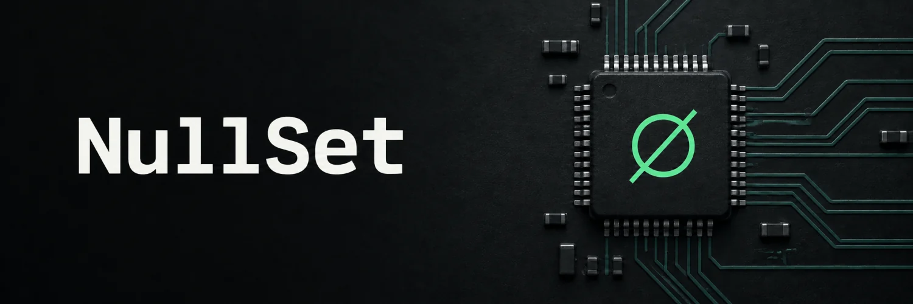

  

  我在学嵌入式 Linux，喜欢写些小工具，也做多模态 AI 实验。

  <a href="https://github.com/NullSetx/Blog">博客源码</a>
  ·
  <a href="https://github.com/NullSetx?tab=repositories">所有仓库</a>

## 精选项目

| 项目 | 简介 |
| :--- | :--- |
| [**Embedded-Linux**](https://github.com/NullSetx/Embedded-Linux) | 从 C 语言、数据结构到 Linux 系统与网络编程的学习笔记。 |
| [**mini-shell**](https://github.com/NullSetx/mini-shell) | 用 C 从零实现 Linux Shell，练习进程管理、管道和重定向。 |
| [**mm-agent**](https://github.com/NullSetx/mm-agent) | 多模态视觉 Agent，按自然语言请求调用目标检测、图像分类和 OCR 等工具。 |
| [**FFmpegBox**](https://github.com/NullSetx/FFmpegBox) | JavaFX 编写的 FFmpeg 图形界面，支持批量转码和音视频分离。 |
| [**GLUT-Schedule**](https://github.com/NullSetx/GLUT-Schedule) | 用 Python 查询教务课表，支持定时推送到钉钉。 |

## 贡献记录

<picture>
  <source media="(prefers-color-scheme: dark)" srcset="./.github/assets/snake-dark.svg">
  <source media="(prefers-color-scheme: light)" srcset="./.github/assets/snake.svg">
  
</picture>

<em>遇事不决，可问春风。</em>

